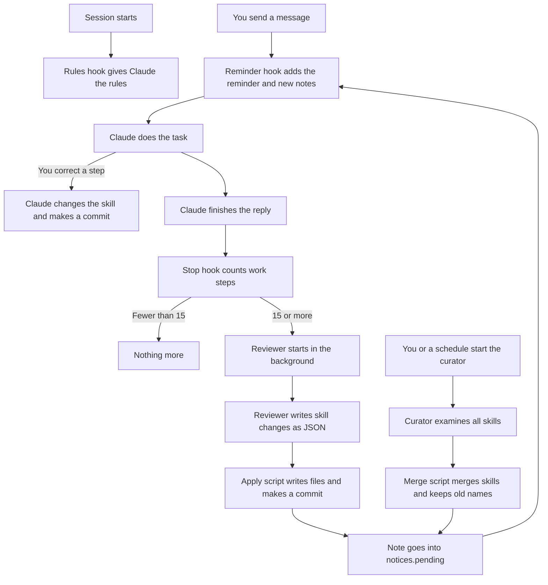

# Self-Learning Skills for Claude Code

Claude Code forgets your corrections when a session ends.
This plugin writes each correction into a skill. All future sessions use the skill.
A background reviewer finds the corrections that Claude did not record. A curator merges similar skills.

**Install with an AI agent.** Give your agent this text:

> Set up https://github.com/oiegorov-embrace/claude-self-learning-skills for me. Read and follow https://raw.githubusercontent.com/oiegorov-embrace/claude-self-learning-skills/main/AGENTS.md

**Install yourself.** Type this command in a terminal, then start Claude Code and type `/self-learning-skills:setup`:

```bash
claude plugin install self-learning-skills --marketplace oiegorov-embrace/claude-self-learning-skills
```

| Before you install | Detail |
| --- | --- |
| Scope | All your Claude Code projects. Your skills go to `~/.claude/skills/`. |
| Cost | Each background review costs approximately USD 0.25 to 0.40 with Opus. |
| Your settings | The plugin does not edit `settings.json` or `CLAUDE.md`. Claude Code adds only the marketplace entry and the plugin entry. |
| Removal | `claude plugin uninstall self-learning-skills@self-learning-skills`. Your skills stay. |

The full instruction follows.

---

# Setup Instruction

> **Language:** This document uses ASD-STE100 Simplified Technical English.
> The files in the `plugins/` folder are in normal English. Claude reads those files, not people.
> Code, commands and file contents stay as they are.

**Applicability:** Claude Code CLI and the Code tab of the Claude desktop app, on macOS. Linux is not tested.
**Status:** The system was tested on 2026-10-15 with Claude Code 2.1.300. The plugin install, the setup and the review pipeline were tested in a temporary home folder.

---

## 1. Purpose

### 1.1 The problem

Claude does not keep the lessons of one session in the next session.
You tell Claude how you do a task. You correct Claude many times.
In a new session, Claude does not know these corrections.
Thus, you must give the same corrections again.

### 1.2 The solution

This system keeps your method of work in **skills**.
A skill is a file with the steps of one type of task.
Claude reads the applicable skill before it does that type of task.

The system makes and changes skills automatically:

- During a session, Claude adds your corrections to the applicable skill.
- After a long part of work, a separate reviewer examines the session. It adds the lessons that Claude did not record.
- When you start it, a curator merges skills that are almost the same. You can schedule it one time each week.
- When the curator merges skills, the old skill names continue to work.

This design copies the "learning loop" of Hermes Agent (Nous Research).

### 1.3 Benefits

- You give a correction one time only. All future sessions use it.
- Claude does tasks in your sequence and with your rules.
- Each skill change is a git commit. You can see each change. You can undo each change.
- The background work does not make you wait.
- The reviewer and the curator cannot run commands. Text in a session cannot make them do dangerous actions.

---

## 2. Components

| Component | Type | When it operates | What it does |
| --- | --- | --- | --- |
| Rules hook | `SessionStart` hook | Each session start and each compaction | Gives Claude the rules for skills. |
| Reminder hook | `UserPromptSubmit` hook | Each user message | Reminds Claude of the rules. Gives Claude the notes from background work. |
| Review trigger | `Stop` hook | After each Claude reply | Counts work steps. At 15 work steps, starts the reviewer. |
| Reviewer | Headless `claude -p`, no tools | In the background | Examines the session. Writes skill changes as JSON. |
| Apply script | Python | After the reviewer | Writes the JSON changes to the skill library. Makes a commit. |
| Setup skill | `/self-learning-skills:setup` | One time, after the installation | Makes the skill library a git repository. |
| Curator skill | `/self-learning-skills:curate` | When you start it, or from a schedule | Finds skills that are almost the same. Merges them. Keeps the old names. |
| Skill library | `~/.claude/skills/` (git repository) | Always | Keeps the skills and their history. |

---

## 3. File hierarchy

This repository is a Claude Code plugin marketplace with the name `self-learning-skills`. It has one plugin.

```text
claude-self-learning-skills/
├── README.md                              This instruction
├── AGENTS.md                              Installation procedure for AI agents
├── install.sh                             Manual installer, if you cannot use plugins (section 6.3)
├── tests/
│   ├── plugin-mode.sh                     Offline test of the plugin scripts (section 7.1)
│   └── merge-safety.sh                    Proof that install.sh merges and does not overwrite (section 7.2)
├── .claude-plugin/marketplace.json        The marketplace (section 4.1)
└── plugins/self-learning-skills/
    ├── .claude-plugin/plugin.json
    ├── hooks/hooks.json                   The three hooks (section 4.2)
    ├── skills/
    │   ├── setup/SKILL.md                 /self-learning-skills:setup (section 4.3)
    │   └── curate/SKILL.md                /self-learning-skills:curate (section 4.4)
    ├── library/                           README.md and REDIRECTS.md for a new skill library
    └── scripts/                           The scripts and prompts (section 4.5)
```

On your computer, the plugin uses these folders:

```text
~/.claude/skills/                                       Your skill library (git repository)
├── <skill-name>/SKILL.md                               Made by Claude, the reviewer or the curator
├── REDIRECTS.md                                        Old name → new name table
├── .archive/                                           Merged skills
└── synced/                                             Made by claude.ai sync. Do not change.
~/.claude/plugins/data/self-learning-skills-self-learning-skills/
├── state/                                              Review position for each session
├── logs/                                               One log set for each review or curator run
├── notices.pending                                     Notes not yet shown
└── notices.seen                                        Notes already shown
```

**NOTE:** Claude Code deletes the plugin data folder when you uninstall the plugin. Your skill library stays.

---

## 4. Files

**CAUTION:** Do not write files into `~/.claude/skills/synced/`. The claude.ai sync replaces the files in that folder.

### 4.1 `.claude-plugin/marketplace.json`

This file makes the repository a plugin marketplace.

**File:** [`.claude-plugin/marketplace.json`](.claude-plugin/marketplace.json)

### 4.2 `hooks/hooks.json`

This file registers the three hooks of the plugin. Claude Code reads it from the plugin. It does not copy it into `settings.json`.

**File:** [`plugins/self-learning-skills/hooks/hooks.json`](plugins/self-learning-skills/hooks/hooks.json)

### 4.3 `skills/setup/SKILL.md`

This skill makes `~/.claude/skills/` a git repository. It does not change your current skills.
Until you do the setup, the plugin does not start reviews. At each session start, Claude tells you to do the setup.

**File:** [`plugins/self-learning-skills/skills/setup/SKILL.md`](plugins/self-learning-skills/skills/setup/SKILL.md)

### 4.4 `skills/curate/SKILL.md`

This skill starts the curator. Only you or a schedule can start it. Claude does not start it automatically.

**File:** [`plugins/self-learning-skills/skills/curate/SKILL.md`](plugins/self-learning-skills/skills/curate/SKILL.md)

### 4.5 `scripts/`

| File | What it does |
| --- | --- |
| [`lib.sh`](plugins/self-learning-skills/scripts/lib.sh) | Finds the folders. Finds a manual installation of the same system. |
| [`rules.md`](plugins/self-learning-skills/scripts/rules.md) | The rules for skills. The rules hook gives this text to Claude. |
| [`session-rules.sh`](plugins/self-learning-skills/scripts/session-rules.sh) | The rules hook (`SessionStart`). |
| [`skill-learning-reminder.sh`](plugins/self-learning-skills/scripts/skill-learning-reminder.sh) | The reminder hook (`UserPromptSubmit`). |
| [`stop-hook.sh`](plugins/self-learning-skills/scripts/stop-hook.sh) | The review trigger (`Stop`). |
| [`run-review.sh`](plugins/self-learning-skills/scripts/run-review.sh) | Sends the session text to the reviewer. Applies the result. Writes a note. |
| [`review-prompt.md`](plugins/self-learning-skills/scripts/review-prompt.md) | The reviewer instructions, adapted from Hermes Agent. |
| [`apply-changes.py`](plugins/self-learning-skills/scripts/apply-changes.py) | Writes only to permitted paths in the skill library. Makes a commit. |
| [`curate.sh`](plugins/self-learning-skills/scripts/curate.sh) | Starts the curator. With fewer than two skills, it stops and does not call the model. |
| [`curator-prompt.md`](plugins/self-learning-skills/scripts/curator-prompt.md) | The curator instructions. |
| [`apply-curation.py`](plugins/self-learning-skills/scripts/apply-curation.py) | Does each merge (section 5.5). |
| [`setup-library.sh`](plugins/self-learning-skills/scripts/setup-library.sh) | Makes the skill library a git repository. |
| [`on-skill-redirect.example`](plugins/self-learning-skills/scripts/on-skill-redirect.example) | Optional link to an external memory, for example Hindsight. |

A work step is one Claude response that uses one or more tools. Many tools in one response are one step.
All tools count, MCP tools also. The hook ignores bookkeeping tools: `mcp__ccd_turn__*` and `ToolSearch`.
If Claude changed a skill in that period, the hook sets the count to zero. It does not start a review.

---

## 5. How the system works

### 5.1 Overview



### 5.2 Sequence at session start

1. A session starts, or Claude Code makes a compaction.
2. The rules hook gives Claude the rules from `rules.md`.
3. If the skill library is not a git repository, the hook adds a note. Claude tells you to do the setup.

### 5.3 Sequence for each message

1. You send a message.
2. The reminder hook adds the reminder to the message.
3. If `notices.pending` has notes, the hook adds them too. Then it moves them to `notices.seen`.
4. Claude tells you about each note in one line.
5. If your message corrects a step of a known task, Claude changes the skill. Claude makes a commit and tells you in one line.

### 5.4 Sequence after each reply (background review)

1. Claude finishes the reply. The `Stop` hook starts.
2. The hook counts the work steps after the last review position.
3. If Claude changed a skill in that period, the hook moves the review position and stops.
4. If the count is less than 15, the hook stops.
5. If the count is 15 or more, the hook starts `run-review.sh` in the background. The hook stops immediately.
6. The reviewer gets the instructions, all skills and the session text. It has no tools.
7. The reviewer writes a `<skill-changes>` JSON block.
8. `apply-changes.py` writes the permitted files and makes a commit.
9. The runner writes a one-line note to `notices.pending`. Section 5.3 shows the note to you.

**NOTE:** A review takes approximately 40 to 60 seconds. With Opus 5.5, it costs approximately USD 0.25 to 0.40.

### 5.5 How old skill names continue to work

The curator merges skills. These items keep each old name available:

| Item | Where | Effect |
| --- | --- | --- |
| Alias | Description of the merged skill: `Formerly: <old-name>` | A request with the old words finds the merged skill. |
| Redirect row | `~/.claude/skills/REDIRECTS.md` | Claude looks here when it cannot find a skill name. |
| Archive | `~/.claude/skills/.archive/<old-name>/` | The old text stays available. |
| External note | `~/.claude/skill-review/on-skill-redirect` (optional) | The external memory gets "use the new skill". |

---

## 6. Installation procedure

### 6.1 Make sure that the prerequisites are available

1. Make sure that Claude Code is installed. Type `claude --version`.
2. Make sure that `jq` and `git` are installed. Type `jq --version` and `git --version`.
3. Make sure that `/usr/bin/python3` exists. Type `/usr/bin/python3 --version`.

### 6.2 Install the plugin (recommended)

1. Type this command:

```bash
claude plugin install self-learning-skills --marketplace oiegorov-embrace/claude-self-learning-skills
```

2. Start Claude Code.
3. Type `/self-learning-skills:setup`. If Claude asks for a name and an e-mail address for git, give them.
4. Start a new session. The reviews start in that session.

**NOTE:** The plugin does not change `settings.json` or `CLAUDE.md`. Claude Code adds only one entry to `extraKnownMarketplaces` and one entry to `enabledPlugins`. The setup changes only `~/.claude/skills/`.

### 6.3 Install without plugins

Use this procedure only if your organization does not let you install plugins.

1. Get the files and run the installer:

```bash
git clone https://github.com/oiegorov-embrace/claude-self-learning-skills.git
cd claude-self-learning-skills && ./install.sh
```

2. If the installer asks for a git identity, type `./install.sh --git-name "<your name>" --git-email "<your e-mail>"`.

The manual installer copies the scripts to `~/.claude/skill-review/`. It adds the rules to `~/.claude/CLAUDE.md` between marker lines. It adds two hooks to `~/.claude/settings.json`.

It merges into your files. It does not replace them. It writes through symlinks. You can run it again. `--uninstall` removes only its own entries.

**CAUTION:** Do not use the plugin and the manual installation together. If you do, the plugin stops its hooks and tells you. Remove one of them (section 8.2).

### 6.4 Schedule the curator (optional)

1. In the Claude desktop app, ask Claude to make a scheduled task.
2. Give Claude the name `weekly-skill-curator`, the prompt `/self-learning-skills:curate` and the schedule `0 10 * * 1`.
3. Make sure that the task shows in the **Scheduled** part of the sidebar.

**NOTE:** Scheduled tasks operate only when the Claude app is open. A missed task starts when you open the app.

---

## 7. Test procedure

### 7.1 Test the plugin scripts

1. In the repository folder, type `tests/plugin-mode.sh`.
2. Make sure that the last line is `14 passed, 0 failed`.

The test uses a temporary home folder and a test `claude` program. It does not call a model. It does not change your files.

### 7.2 Test the manual installer

1. In the repository folder, type `tests/merge-safety.sh`.
2. Make sure that the last line is `11 passed, 0 failed`.

### 7.3 Test in a real session

1. Do a task in a session with 15 or more work steps. Correct Claude at least one time.
2. Wait approximately one minute after the reply.
3. Send a new message.
4. Make sure that Claude tells you about a "Background skill review" change.
5. Type `git -C ~/.claude/skills log --oneline`. Make sure that a commit with "(background review)" exists.

---

## 8. Settings and maintenance

| Setting | Where | Default | Effect |
| --- | --- | --- | --- |
| `SKILL_REVIEW_THRESHOLD` | `env` in `settings.json` | `15` | Number of work steps before a review |
| `SKILL_REVIEW_IGNORE_TOOLS` | `env` in `settings.json` | `^(mcp__ccd_turn__.*\|ToolSearch)$` | Regular expression. The hook does not count the tools that agree with it. |
| `SKILL_REVIEW_MODEL` | `env` in `settings.json` | `claude-opus-5-5` | Model for the reviewer. `claude-sonnet-5-5` costs less. |
| `CURATOR_MODEL` | `env` in `settings.json` | `claude-opus-5-5` | Model for the curator |

### 8.1 Undo a skill change

1. Find the commit:

```bash
git -C ~/.claude/skills log --oneline
```

2. Undo the commit. Change `<commit>` to the commit ID:

```bash
git -C ~/.claude/skills revert <commit>
```

### 8.2 Remove the system

1. Remove the plugin:

```bash
claude plugin uninstall self-learning-skills@self-learning-skills
```

2. For a manual installation, type `./install.sh --uninstall` in the repository folder.
3. Delete the `weekly-skill-curator` scheduled task, if you made one.

**NOTE:** Your skill library `~/.claude/skills/` stays. Delete it yourself if you do not want it.

### 8.3 Update the plugin

1. Type `claude plugin update self-learning-skills@self-learning-skills`.

---

## 9. Troubleshooting

In this table, `<data>` is `~/.claude/plugins/data/self-learning-skills-self-learning-skills/` for the plugin and `~/.claude/skill-review/` for a manual installation.

| Symptom | Possible cause | Action |
| --- | --- | --- |
| Claude says "SETUP NEEDED" | The skill library is not a git repository | Type `/self-learning-skills:setup`. |
| Claude says the plugin is inactive | The manual installation is also registered | Remove one of them (section 8.2). |
| Note says "Background skill review failed" | The headless `claude` did not start, or it gave no JSON block | Read the `.err` and `.json` files in `<data>/logs/`. |
| No review after a long task | The count is less than 15, or Claude changed a skill in that period | Examine `<data>/state/<session-id>.line`. |
| A review never starts again | A lock folder stayed after a crash | Remove `<data>/state/<session-id>.lock`. |
| The curator never starts | A lock folder stayed after a crash | Remove `<data>/curator.lock`. |
| `plugin install` fails with a git error | The computer has no GitHub SSH key | Set `CLAUDE_CODE_PLUGIN_PREFER_HTTPS=1`, then try again. |
