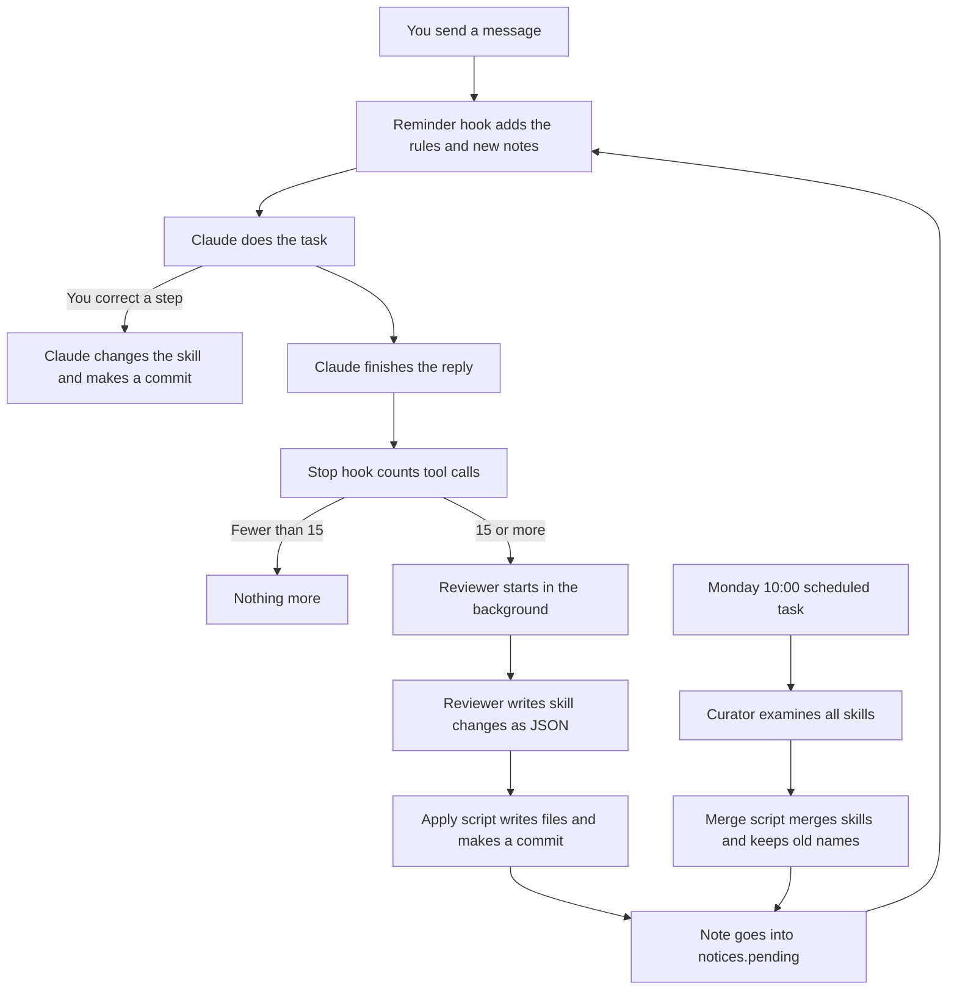

# Self-Learning Skills for Claude Code: Setup Instruction

> **Language:** This document uses ASD-STE100 Simplified Technical English.
> The files in the `dot-claude/` folder are in normal English. Claude reads those files, not people.

**Applicability:** Claude Code CLI and the Code tab of the Claude desktop app, on macOS.
**Status:** The system was tested on 2026-10-15 with Claude Code 2.1.300.

---

## 1. Purpose

### 1.1 The problem

Claude does not keep the lessons of one session in the next session.
You tell Claude how you do a task. You correct Claude many times.
In a new session, Claude does not know these corrections.
Thus, you must give the same corrections again.

### 1.2 The solution

This system keeps your method of work in **skills**.
A skill is a file with the steps of one type of task.
Claude reads the applicable skill before it does that type of task.

The system makes and changes skills automatically:

- During a session, Claude adds your corrections to the applicable skill.
- After a long part of work, a separate reviewer examines the session. It adds the lessons that Claude did not record.
- One time each week, a curator merges skills that are almost the same.
- When the curator merges skills, the old skill names continue to work.

This design copies the "learning loop" of Hermes Agent (Nous Research).

### 1.3 Benefits

- You give a correction one time only. All future sessions use it.
- Claude does tasks in your sequence and with your rules.
- Each skill change is a git commit. You can see each change. You can undo each change.
- The background work does not make you wait.
- The reviewer and the curator cannot run commands. Text in a session cannot make them do dangerous actions.

---

## 2. Components

| Component | Type | When it operates | What it does |
| --- | --- | --- | --- |
| Rules | `~/.claude/CLAUDE.md` | Each session | Tells Claude how to make and change skills. |
| Skill library | `~/.claude/skills/` (git repository) | Always | Keeps the skills and their history. |
| Reminder hook | `UserPromptSubmit` hook | Each user message | Reminds Claude of the rules. Gives Claude the notes from background work. |
| Review trigger | `Stop` hook | After each Claude reply | Counts tool calls. At 15 tool calls, starts the reviewer. |
| Reviewer | Headless `claude -p`, no tools | In the background | Examines the session. Writes skill changes as JSON. |
| Apply script | Python | After the reviewer | Writes the JSON changes to the skill library. Makes a commit. |
| Curator | Headless `claude -p`, no tools | Each Monday 10:00 | Finds skills that are almost the same. Writes merges as JSON. |
| Merge script | Python | After the curator | Merges skills. Keeps old names in aliases and in `REDIRECTS.md`. |
| Scheduled task | Claude app scheduled task | Each Monday 10:00 | Starts the curator. |

---

## 3. File hierarchy

This repository has a `dot-claude/` folder. Its structure agrees with `~/.claude/` on your computer.
Section 4 gives a link to each file.

```text
claude-self-learning-skills/
├── README.md                          This instruction
└── dot-claude/                        Copy of the files for ~/.claude/
    ├── CLAUDE.md
    ├── settings.hooks.json            The hooks part of settings.json
    ├── hooks/
    ├── skill-review/
    ├── skills/
    └── scheduled-tasks/
```

On your computer, the system uses these files:

```text
~/.claude/
├── CLAUDE.md                          Rules for all sessions (section 4.1)
├── settings.json                      Hook registration (section 4.2)
├── hooks/
│   └── skill-learning-reminder.sh     Reminder hook (section 4.3)
├── skill-review/
│   ├── stop-hook.sh                   Review trigger (section 4.4)
│   ├── run-review.sh                  Reviewer runner (section 4.5)
│   ├── review-prompt.md               Reviewer instructions (section 4.6)
│   ├── apply-changes.py               Apply script (section 4.7)
│   ├── curate.sh                      Curator runner (section 4.8)
│   ├── curator-prompt.md              Curator instructions (section 4.9)
│   ├── apply-curation.py              Merge script (section 4.10)
│   ├── on-skill-redirect.example      External memory link, optional (section 4.11)
│   ├── state/                         Made automatically: review position per session
│   ├── logs/                          Made automatically: one log set per run
│   ├── notices.pending                Made automatically: notes not yet shown
│   └── notices.seen                   Made automatically: notes already shown
├── skills/                            Git repository
│   ├── README.md                      (section 4.12)
│   ├── REDIRECTS.md                   Old name → new name table (section 4.13)
│   ├── <skill-name>/SKILL.md          Made by Claude, the reviewer or the curator
│   ├── .archive/                      Made automatically: merged skills
│   └── synced/                        Made by claude.ai sync. Do not change.
└── scheduled-tasks/
    └── weekly-skill-curator/
        └── SKILL.md                   Made by the Claude app (section 4.14)
```

---

## 4. Files

Each file is in the `dot-claude/` folder of this repository. Its path agrees with its path under `~/.claude/`.

**CAUTION:** Do not write files into `~/.claude/skills/synced/`. The claude.ai sync replaces the files in that folder.

### 4.1 `~/.claude/CLAUDE.md`

Claude reads this file at the start of each session in each project.
It has the rules for skills. Add this text to the file. If the file does not exist, make it.

**File:** [`dot-claude/CLAUDE.md`](dot-claude/CLAUDE.md)

### 4.2 `~/.claude/settings.json` (hooks part)

This part registers the two hooks. Add the `hooks` key to your current settings.
Do not remove the other keys in the file.

**File:** [`dot-claude/settings.hooks.json`](dot-claude/settings.hooks.json)

### 4.3 `~/.claude/hooks/skill-learning-reminder.sh`

This hook operates when you send a message.
It adds a short reminder to your message. Only Claude sees the reminder.
It also moves the notes of the reviewer and the curator from `notices.pending` to Claude.

**File:** [`dot-claude/hooks/skill-learning-reminder.sh`](dot-claude/hooks/skill-learning-reminder.sh)

### 4.4 `~/.claude/skill-review/stop-hook.sh`

This hook operates after each Claude reply.
It counts the tool calls since the last review. At 15, it starts `run-review.sh` in the background.
If Claude changed a skill in that period, the hook sets the count to zero. It does not start a review.

**File:** [`dot-claude/skill-review/stop-hook.sh`](dot-claude/skill-review/stop-hook.sh)

### 4.5 `~/.claude/skill-review/run-review.sh`

This script makes a short text version of the session.
It sends the instructions, the skill library and the session text to a headless Claude.
That Claude has no tools. Then the script applies the result and writes a note.

**File:** [`dot-claude/skill-review/run-review.sh`](dot-claude/skill-review/run-review.sh)

### 4.6 `~/.claude/skill-review/review-prompt.md`

These are the reviewer instructions. They are an adapted version of the Hermes Agent review prompt.

**File:** [`dot-claude/skill-review/review-prompt.md`](dot-claude/skill-review/review-prompt.md)

### 4.7 `~/.claude/skill-review/apply-changes.py`

This script reads the JSON block from the reviewer.
It writes only to permitted paths in the skill library. Then it makes a git commit.

**File:** [`dot-claude/skill-review/apply-changes.py`](dot-claude/skill-review/apply-changes.py)

### 4.8 `~/.claude/skill-review/curate.sh`

This script starts the curator. If the library has fewer than two skills, it stops and does not call the model.

**File:** [`dot-claude/skill-review/curate.sh`](dot-claude/skill-review/curate.sh)

### 4.9 `~/.claude/skill-review/curator-prompt.md`

These are the curator instructions.

**File:** [`dot-claude/skill-review/curator-prompt.md`](dot-claude/skill-review/curator-prompt.md)

### 4.10 `~/.claude/skill-review/apply-curation.py`

This script does each merge. It makes sure that each old name stays available:

1. It writes the merged skill. It adds `Formerly: <old-name>` to the description.
2. It moves the support files of the old skill into the merged skill.
3. It moves the old folder to `.archive/`. It does not delete the folder.
4. It adds a row to `REDIRECTS.md`.
5. It makes a git commit.
6. It starts `on-skill-redirect` for each old name, if that file exists.

**File:** [`dot-claude/skill-review/apply-curation.py`](dot-claude/skill-review/apply-curation.py)

### 4.11 `~/.claude/skill-review/on-skill-redirect.example` (optional)

An external memory (for example, Hindsight) can keep the name of an old skill.
This file sends "use the new skill" to the external memory.
To use it, copy it to `on-skill-redirect`, write the memory call, and make it executable.

**File:** [`dot-claude/skill-review/on-skill-redirect.example`](dot-claude/skill-review/on-skill-redirect.example)

### 4.12 `~/.claude/skills/README.md`

**File:** [`dot-claude/skills/README.md`](dot-claude/skills/README.md)

### 4.13 `~/.claude/skills/REDIRECTS.md`

Start with this empty table. The merge script adds the rows.

**File:** [`dot-claude/skills/REDIRECTS.md`](dot-claude/skills/REDIRECTS.md)

### 4.14 Scheduled task: `weekly-skill-curator`

The Claude app makes this file when you make the scheduled task (step 6.6).
Use this text as the task prompt. Use the cron expression `0 10 * * 1` (Monday, 10:00, local time).

**File:** [`dot-claude/scheduled-tasks/weekly-skill-curator/SKILL.md`](dot-claude/scheduled-tasks/weekly-skill-curator/SKILL.md)

---

## 5. How the system works

### 5.1 Overview



### 5.2 Sequence for each message

1. You send a message.
2. The reminder hook adds the rules reminder to the message.
3. If `notices.pending` has notes, the hook adds them too. Then it moves them to `notices.seen`.
4. Claude tells you about each note in one line.
5. If your message corrects a step of a known task, Claude changes the skill. Claude makes a commit and tells you in one line.

### 5.3 Sequence after each reply (background review)

1. Claude finishes the reply. The `Stop` hook starts.
2. The hook reads the session transcript. It counts the tool calls after the last review position.
3. If Claude changed a skill in that period, the hook moves the review position and stops.
4. If the count is less than 15, the hook stops.
5. If the count is 15 or more, the hook moves the review position. It starts `run-review.sh` in the background. The hook stops immediately.
6. `run-review.sh` makes a short text of the session. The new part is marked for review. The old part is context only.
7. The reviewer gets the instructions, all skills and the session text. It has no tools.
8. The reviewer writes a `<skill-changes>` JSON block.
9. `apply-changes.py` writes the permitted files and makes a commit.
10. The runner writes a one-line note to `notices.pending`. Section 5.2 shows the note to you.

**NOTE:** A review takes approximately 40 to 60 seconds. With Opus 5.5, it costs approximately USD 0.25 to 0.40.

### 5.4 Weekly sequence (curator)

1. On Monday at 10:00, the Claude app starts the scheduled task. If the app is closed at that time, the task starts when you open the app.
2. The task runs `curate.sh`.
3. If the library has fewer than two skills, the script stops.
4. The curator gets all skills. It has no tools. It writes a `<curation>` JSON block.
5. `apply-curation.py` does each merge (section 4.10).
6. The script writes a note to `notices.pending`. You see the note in your next session.

### 5.5 How old skill names continue to work

Your memory, Claude memory or an external memory can keep the name of a skill.
After a merge, that name is not a folder in the library.
These items keep the old name available:

| Item | Where | Effect |
| --- | --- | --- |
| Alias | Description of the merged skill: `Formerly: <old-name>` | A request with the old words finds the merged skill. |
| Redirect row | `~/.claude/skills/REDIRECTS.md` | Claude looks here when it cannot find a skill name. |
| Archive | `~/.claude/skills/.archive/<old-name>/` | The old text stays available. |
| External note | `on-skill-redirect` (optional) | The external memory gets "use the new skill". |

---

## 6. Installation procedure

**WARNING:** Make a backup copy of `~/.claude/settings.json` before you change it. An incorrect file can stop all hooks.

### 6.1 Make sure that the prerequisites are available

1. Make sure that Claude Code is installed. Type `claude --version`.
2. Make sure that `jq` is installed. Type `jq --version`.
3. Make sure that `git` is installed. Type `git --version`.
4. Make sure that `/usr/bin/python3` exists. On Linux, change this path in `run-review.sh` and `curate.sh`.

### 6.2 Get the files

1. Type these commands:

```bash
git clone https://github.com/oiegorov-embrace/claude-self-learning-skills.git
cd claude-self-learning-skills/dot-claude
```

### 6.3 Copy the files

**CAUTION:** Do not copy `CLAUDE.md` on top of your current file. Add its text to the end of your file.

1. Make the folders:

```bash
mkdir -p ~/.claude/skills ~/.claude/backups
```

2. Copy the hooks, the scripts and the skill library files:

```bash
cp -R hooks skill-review ~/.claude/
cp skills/README.md skills/REDIRECTS.md ~/.claude/skills/
```

3. Add the rules to your `CLAUDE.md`:

```bash
cat CLAUDE.md >> ~/.claude/CLAUDE.md
```

4. Make the shell scripts executable:

```bash
chmod +x ~/.claude/hooks/skill-learning-reminder.sh ~/.claude/skill-review/*.sh
```

### 6.4 Make the skill library a git repository

1. Type these commands. Use your name and your e-mail address.

```bash
cd ~/.claude/skills
git init -b main
printf 'synced/\n.DS_Store\n' > .gitignore
git config user.name "<your name>"
git config user.email "<your e-mail>"
git add -A
git commit -m "Initialize personal skills repo"
```

**NOTE:** These `git config` commands change only this repository. They do not change your global git settings.

### 6.5 Register the hooks

1. Make a backup copy of the settings file:

```bash
cp ~/.claude/settings.json ~/.claude/backups/settings.json.before-skills
```

2. Add the `hooks` key from `dot-claude/settings.hooks.json` to `~/.claude/settings.json`.
3. Make sure that the file is valid JSON:

```bash
jq empty ~/.claude/settings.json && echo valid
```

### 6.6 Make the weekly scheduled task

1. In a Claude Code session in the desktop app, ask Claude to make a scheduled task.
2. Give Claude the name `weekly-skill-curator`, the prompt in `dot-claude/scheduled-tasks/weekly-skill-curator/SKILL.md` and the schedule `0 10 * * 1`.
3. Make sure that the task shows in the **Scheduled** part of the sidebar.

**NOTE:** Scheduled tasks operate only when the Claude app is open. A missed task starts when you open the app.

---

## 7. Test procedure

### 7.1 Test the reminder hook

1. Type this command:

```bash
echo '{}' | ~/.claude/hooks/skill-learning-reminder.sh | jq .
```

2. Make sure that the output has `additionalContext` with the "Skill check" text.

### 7.2 Test the background review

1. Do a task in a session with 15 or more tool calls. Correct Claude at least one time.
2. Wait approximately one minute after the reply.
3. Send a new message.
4. Make sure that Claude tells you about a "Background skill review" change.
5. Type `git -C ~/.claude/skills log --oneline`. Make sure that a commit with "(background review)" exists.

### 7.3 Test the curator on a test library

**CAUTION:** Do not test the curator on your real library first. Use a test copy.

1. Make a test folder with a git repository. Put two skills that are almost the same in it. Put one different skill in it.
2. Type this command. Change `<test-folder>` to your test folder.

```bash
SKILLS_DIR=<test-folder> NOTICES=<test-folder>/notices ~/.claude/skill-review/curate.sh
```

3. Make sure that the two similar skills are now one skill.
4. Make sure that the description of the merged skill has `Formerly: <old-name>`.
5. Make sure that the old folder is in `.archive/`.
6. Make sure that `REDIRECTS.md` has a new row.
7. Make sure that the different skill did not change.

---

## 8. Settings and maintenance

| Setting | Where | Default | Effect |
| --- | --- | --- | --- |
| `SKILL_REVIEW_THRESHOLD` | Environment variable | `15` | Number of tool calls before a review |
| `SKILL_REVIEW_MODEL` | Environment variable | `claude-opus-5-5` | Model for the reviewer. `claude-sonnet-5-5` costs less. |
| `CURATOR_MODEL` | Environment variable | `claude-opus-5-5` | Model for the curator |
| Schedule | Claude app, **Scheduled** | Monday 10:00 | Time of the curator run |

### 8.1 Undo a skill change

1. Find the commit:

```bash
git -C ~/.claude/skills log --oneline
```

2. Undo the commit. Change `<commit>` to the commit ID:

```bash
git -C ~/.claude/skills revert <commit>
```

### 8.2 Stop the system

1. Remove the `Stop` entry from `~/.claude/settings.json` to stop background reviews.
2. Pause the `weekly-skill-curator` task in the Claude app to stop the curator.
3. Remove the `UserPromptSubmit` entry to stop the reminders.

---

## 9. Troubleshooting

| Symptom | Possible cause | Action |
| --- | --- | --- |
| Note says "Background skill review failed" | The headless `claude` did not start, or it gave no JSON block | Read the `.err` and `.json` files in `~/.claude/skill-review/logs/`. |
| No review after a long task | The count is less than 15, or Claude changed a skill in that period | Examine `~/.claude/skill-review/state/<session-id>.line`. |
| A review never starts again | A lock folder stayed after a crash | Remove `~/.claude/skill-review/state/<session-id>.lock`. |
| The curator never starts | A lock folder stayed after a crash | Remove `~/.claude/skill-review/curator.lock`. |
| The reviewer writes nothing to `~/.claude/` when it has tools | Claude Code protects `~/.claude/` from headless writes | Keep the reviewer without tools. The apply script writes the files. |
| `head: illegal line count -- 0` | Old version of `run-review.sh` on macOS | Use the version in section 4.5. |
